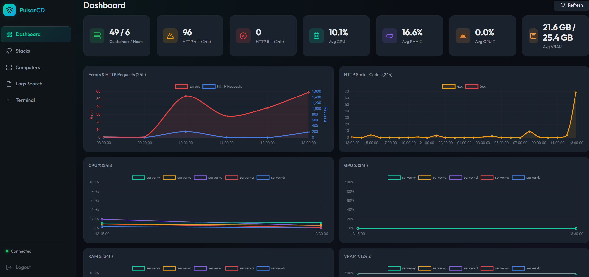
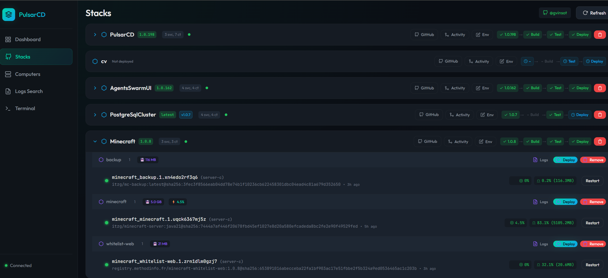
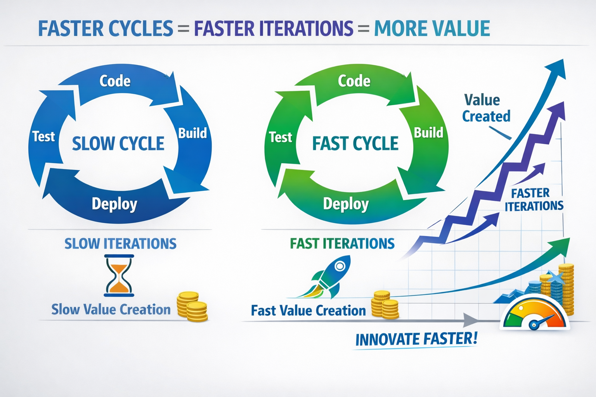

# PulsarCD

Encrypted `.env` and SSH recovery backups: [configuration and recovery procedure](docs/RECOVERY.md).

### The fastest path from code to deploy. No gates. No waiting. Just ship.


*Dashboard: Real-time metrics, error tracking, and resource monitoring*


*Stacks: Build and deploy directly from your GitHub repositories*

---

## Our Thesis

**The speed of your iteration cycle is the single most important factor in how fast you build software.**

Every minute spent waiting for a build, switching between tools, SSH-ing into a machine, or manually checking logs is a minute not spent creating. Traditional DevOps workflows are fragmented by design — GitHub over here, CI/CD over there, monitoring somewhere else, deployment in yet another tool. Each context switch kills momentum. Each manual step is a bottleneck.




We believe that compressing the cycle **commit → build → deploy → observe** into the shortest possible loop is the key to unlocking a new speed of development.

## The AI Bet

We're making a deliberate, all-in bet: **AI will very soon be reliable enough to trust with the entire software delivery pipeline.**

Today, LLMs can already search your logs in natural language, analyze error patterns, and suggest fixes. Tomorrow, they'll be able to autonomously detect a regression, roll back a deployment, and open a PR with the fix — all without human intervention.

**PulsarCD is built for that future.** Every design decision — the fully integrated architecture, the single-pane-of-glass approach, the AI-native log analysis — is made so that when AI becomes reliable enough, there are zero barriers between it and your infrastructure. No fragmented tools to bridge. No manual approval gates to bypass. Just a single, unified platform where an AI agent can observe, decide, and act.

### Honest Reality Check

Today, AI is not reliable enough to run production unsupervised. We know that. PulsarCD is already a **perfect environment for development and staging** — where the speed gains are massive and the risk is low. You get the fastest iteration cycle possible, with AI-assisted observability that makes debugging feel like having a conversation.

For production? Not yet. But the gap is closing fast. And when it does, PulsarCD will already be there — fully integrated, no assembly required.

> **TL;DR** — We're building the platform that will let AI ship your code to production. Today it accelerates your dev workflow. Tomorrow it runs the whole show.

---

## What PulsarCD Does

**One tool. One interface. Complete control.** Stop switching between GitHub, Portainer, Grafana, and terminal windows.

| Build | Deploy | Monitor | Manage |
|-------|--------|---------|--------|
| Clone from GitHub | Docker Swarm stacks | Centralized logs | Start/Stop containers |
| Multi-branch builds | Environment config | Real-time metrics | Exec into containers |
| Version tagging | Rolling updates | AI-powered search | Resource limits |
| Build history | Rollback support | Error tracking | Grouped views |

## Features

### GitHub Integration
- **Starred Repos**: Your starred repositories appear automatically
- **Branch Selection**: Build from any branch or specific commit
- **Compose Detection**: Automatically finds docker-compose files
- **Version Management**: Tag your builds with semantic versions

### Build & Deploy
- **One-Click Builds**: Build Docker images directly from your repos
- **Docker Swarm**: Deploy as Swarm stacks for high availability
- **Environment Management**: Configure environment variables per stack
- **Tag Selection**: Deploy specific versions or latest builds
- **Verified Deploys & Auto-Rollback**: A deploy only succeeds once every service runs the new version (and an optional health URL answers); otherwise the previous version is redeployed automatically — see [Post-deploy verification and rollback](#post-deploy-verification-and-rollback)
- **Run History**: Every build, test, QA and deploy run is kept in VictoriaLogs with its full, searchable log (who/what triggered it, version, commit, duration, error excerpt) - Stacks > History
- **Notifications**: Pipeline failures, automatic edge bans and recurring errors pushed to ntfy, a Discord/Slack webhook or e-mail (see [Notifications](#notifications))
- **Branch Previews**: Deploy any branch as an isolated preview at `<branch-slug>.<your-host>`, with automatic expiry (see [Preview environments](#preview-environments))

### Monitoring & Logs
- **Centralized Log Collection**: Agents collect logs from all containers across all hosts
- **Full-Text Search**: Case-insensitive search over every container log, plus LogsQL for statistics (VictoriaLogs)
- **AI-Powered Search**: Natural language queries via Ollama (e.g., "show me errors from nginx in the last hour")
- **Real-Time Metrics**: CPU, Memory, GPU (AMD/NVIDIA), Disk usage
- **Error Tracking**: 4xx/5xx HTTP error counts and trends

### Usage
- **Endpoint Statistics**: Which URLs the platform actually serves - requests, share, distinct clients, latency and errors per endpoint, host and domain
- **Per-Stack Breakdown**: The whole platform at once, or one stack, resolved from the Traefik router that served each request

The Usage view reads the same access index as the Security view - the Traefik
JSON access log, copied by the agent running on the edge node. An access log
line names the *router* that served the request, never the stack behind it, so
PulsarCD reads the `traefik.http.routers.*` labels off the Swarm services and
maps each router to its `com.docker.stack.namespace`. Requests no deployed
stack claims - a router served from Traefik's own file configuration, a stack
removed since, or a scan of the bare IP address that matched no router at all -
are reported as **unattributed** rather than dropped, so the per-stack rows
always add up to the total above them.

### Security
- **Attack Detection**: Client IPs and endpoints ranked from the Traefik access logs and Coraza WAF blocks - floods, scanners, credential probing - attack categories (injection, traversal, secrets, known exploits, WordPress, PHP, backups) with the probes that got a 2xx, and a request explorer; click a bar of the timeline to focus everything on that time slot
- **Block at the Edge**: Refuse an address or CIDR range in Traefik, in front of the WAF, without redeploying anything

### Container Management
- **Multi-Host View**: See all containers grouped by host and Compose project
- **Container Actions**: Start, Stop, Restart, Pause/Unpause from the UI
- **Live Logs**: Stream container logs in real-time
- **Resource Stats**: Monitor CPU/Memory usage per container

### Dashboard
- **Summary Statistics**: Running containers, hosts, error counts at a glance
- **Time Series Charts**: Visualize resource usage and error patterns over 24h
- **HTTP Status Distribution**: Track 4xx/5xx breakdown

## Architecture

PulsarCD uses an **agent-based architecture** where lightweight agents run on each host:

```
┌─────────────────────────────────────────────────────────────────────────────┐
│                           Central Server                                    │
│  ┌─────────────┐    ┌─────────────────┐    ┌──────────────┐                 │
│  │  Frontend   │    │    FastAPI      │    │    Ollama    │                 │
│  │  (HTML/JS)  │◄──►│    Backend      │◄──►│   (AI/LLM)   │                 │
│  └─────────────┘    └────────┬────────┘    └──────────────┘                 │
│                              │                                              │
│                      ┌───────┴───────┐                                      │
│                      │   Actions     │◄──── Container actions queue         │
│                      │    Queue      │      (start, stop, exec, etc.)       │
│                      └───────┬───────┘                                      │
└──────────────────────────────┼──────────────────────────────────────────────┘
                               │ Agents poll for actions
                               ▼
┌──────────────────────────────────────────────────────────────────────────────┐
│                           VictoriaLogs                                       │
│           (Logs, Metrics, Access records, Run history, Search)               │
└────────────────────────────────▲─────────────────────────────────────────────┘
                                 │ Direct writes
         ┌───────────────────────┼───────────────────────┐
         │                       │                       │
┌────────┴────────┐    ┌─────────┴───────┐    ┌─────────┴───────┐
│    Host 1       │    │     Host 2      │    │     Host N      │
│  ┌───────────┐  │    │  ┌───────────┐  │    │  ┌───────────┐  │
│  │   Agent   │  │    │  │   Agent   │  │    │  │   Agent   │  │
│  └─────┬─────┘  │    │  └─────┬─────┘  │    │  └─────┬─────┘  │
│        │        │    │        │        │    │        │        │
│  ┌─────▼─────┐  │    │  ┌─────▼─────┐  │    │  ┌─────▼─────┐  │
│  │  Docker   │  │    │  │  Docker   │  │    │  │  Docker   │  │
│  │ Containers│  │    │  │ Containers│  │    │  │ Containers│  │
│  └───────────┘  │    │  └───────────┘  │    │  └───────────┘  │
└─────────────────┘    └─────────────────┘    └─────────────────┘
```

### How It Works

1. **Agents** run on each host and:
   - Collect Docker container logs and metrics locally
   - Write data directly to VictoriaLogs (no backend bottleneck)
   - Poll the backend for actions (start, stop, restart, exec commands)
   - Execute container actions and report results

2. **Backend** serves as the coordination layer:
   - Provides REST API for the frontend
   - Manages the actions queue for agent communication
   - Integrates with Ollama for AI-powered log search
   - Handles GitHub integration for stack deployment

   **Restarts and replicas.** The actions queue is mirrored to
   `/data/actions_queue.json`: after a backend restart, actions still waiting for
   their agent are delivered (within their original 60-second TTL), actions an
   agent had already picked up are marked `failed` with a `reason` (a late result
   from the agent still replaces it), and agents' last-seen times are restored.
   Action results are never written to disk. Pipeline runs found `running` in
   `/data/pipeline_state.json` at startup are marked `failed` with a
   `status_reason` ("interrupted by a backend restart") instead of spinning
   forever; start the pipeline again to resume. Both files are owned by a single
   backend process, so the backend must keep running with `replicas: 1`: several
   replicas would each hold their own queue and overwrite each other's files.

3. **Frontend** provides the user interface:
   - Dashboard with metrics and error trends
   - Log search with natural language support
   - Container management across all hosts
   - Stack deployment from GitHub

## Quick Start

### Prerequisites

- Docker & Docker Compose
- Docker installed on all hosts you want to monitor

### 1. Start the Central Server

```bash
git clone https://github.com/yourusername/pulsarcd.git
cd pulsarcd

# Sign-in is Google-only: create an OAuth 2.0 Web client (see
# "Signing in" under Security Hardening), then list who may get in.
export PULSARCD_AUTH__GOOGLE_CLIENT_ID=<your-client-id>.apps.googleusercontent.com
export PULSARCD_AUTH__GOOGLE_ADMINS=you@example.com

# Start backend, frontend, and VictoriaLogs
docker-compose up -d
```

### 2. Deploy Agents on Each Host

Agents are deployed in **global mode** across the Docker Swarm via
`devops/docker-compose.swarm.yml` — one agent runs on every node automatically.
There is no separate per-host compose file.

```bash
# From the swarm manager node
docker stack deploy -c devops/docker-compose.swarm.yml pulsarcd
```

### 3. Access the Dashboard

Open http://localhost:5000 in your browser and sign in with one of the Google
accounts you listed above. Add `http://localhost:5000` to the OAuth client's
authorised JavaScript origins or the button will not appear.

## Configuration

### Central Server Configuration

All configuration is done via **environment variables** in `docker-compose.yml`:

```yaml
environment:
  # Log, metrics and run-history store
  - PULSARCD_VICTORIALOGS__URL=http://victorialogs:9428

  # AI/Ollama configuration (optional - for natural language search)
  - PULSARCD_AI__MODEL=llama3.2:latest
  - PULSARCD_OLLAMA_URL=http://your-ollama-server:11434

  # GitHub integration (optional - for stack deployment)
  - PULSARCD_GITHUB__TOKEN=ghp_your_token_here

  # Collector settings
  - PULSARCD_COLLECTOR__LOG_INTERVAL_SECONDS=30
  - PULSARCD_COLLECTOR__METRICS_INTERVAL_SECONDS=15
```

### Agent Configuration

Configure each agent via environment variables in `devops/docker-compose.swarm.yml`:

```yaml
environment:
  # Unique agent ID (defaults to hostname)
  - AGENT_AGENT_ID=${AGENT_ID:-$(hostname)}

  # Backend URL for polling actions
  - AGENT_BACKEND_URL=http://pulsarcd-backend:5000

  # VictoriaLogs (direct writes)
  - AGENT_VICTORIALOGS__URL=http://victorialogs:9428

  # Collection intervals (seconds)
  - AGENT_LOG_INTERVAL=30
  - AGENT_METRICS_INTERVAL=15
  - AGENT_ACTION_POLL_INTERVAL=2
```

### Legacy SSH Mode (Optional)

For backwards compatibility, you can still monitor remote hosts via SSH from the central server:

```yaml
environment:
  - |
    PULSARCD_HOSTS=[
      {"name": "local", "mode": "docker"},
      {"name": "server-1", "mode": "ssh", "hostname": "192.168.1.10", "username": "deploy"},
      {"name": "server-2", "mode": "ssh", "hostname": "192.168.1.11", "username": "deploy"}
    ]
volumes:
  - ~/.ssh:/root/.ssh:ro  # Mount SSH keys
```

## Development Setup

### Without Docker

```bash
# Create virtual environment
python -m venv venv
source venv/bin/activate  # Linux/macOS
# or: venv\Scripts\activate  # Windows

# Install dependencies
pip install -r requirements.txt

# Start VictoriaLogs (required)
# It has NO authentication at all: publish it on the loopback interface only,
# never on 0.0.0.0. See the Security Hardening section below.
docker run -d -p 127.0.0.1:9428:9428 victoriametrics/victoria-logs:v1.53.0
export PULSARCD_VICTORIALOGS__URL=http://127.0.0.1:9428

# Run the application
python -m backend.main
```

### Tests and Static Checks

```bash
pip install pytest pytest-asyncio "httpx>=0.23.0,<0.28.0" "ruff==0.17.1" "mypy==2.4.0" "pip-audit==2.10.1"  # same pins as the Dockerfile
python -m pytest tests/ -q
bash scripts/static-checks.sh   # ruff + mypy (blocking), pip-audit (warning only)
```

The Dockerfile `test` stage runs `scripts/static-checks.sh` while building, so a
ruff or mypy error fails the test build (and `scripts/test.sh`) before any test
runs. Both tools are configured permissively in `pyproject.toml`: they report
likely bugs (undefined names, unknown attributes, wrong call signatures), not
style. pip-audit only warns because the deliberately pinned FastAPI/Starlette
and PyJWT versions carry advisories until the framework upgrade; set
`PULSARCD_SKIP_AUDIT=1` to skip it offline.

### Project Structure

```
pulsarcd/
├── backend/
│   ├── __init__.py
│   ├── api.py              # FastAPI app: lifespan, shared state, middleware and router registration
│   ├── routes/             # REST endpoints, one APIRouter module per domain
│   ├── auth_middleware.py  # /api/ authentication and role policy
│   ├── security_headers.py # CSP / HSTS response headers
│   ├── pipeline_runner.py  # Build → test → deploy chain and auto-build poller
│   ├── actions_queue.py    # Agent actions queue (persisted to /data)
│   ├── ai_service.py       # Ollama integration for NL queries
│   ├── collector.py        # Legacy log/metrics collection service
│   ├── config.py           # Configuration management (env vars)
│   ├── docker_client.py    # Docker API client
│   ├── github_service.py   # GitHub integration for stack deployment
│   ├── host_client.py      # Unified host client interface
│   ├── main.py             # Application entry point
│   ├── models.py           # Pydantic data models
│   ├── log_store.py        # Log, metrics and access-record queries (VictoriaLogs)
│   ├── ssh_client.py       # SSH client for remote hosts (legacy)
│   └── utils.py            # Utility functions
├── agent/
│   ├── __init__.py
│   ├── action_poller.py    # Polls backend for container actions
│   ├── config.py           # Agent configuration
│   ├── docker_collector.py # Local Docker log/metrics collection
│   ├── main.py             # Agent entry point
│   ├── victorialogs_writer.py # Direct VictoriaLogs writes
│   ├── requirements.txt    # Agent-specific dependencies
│   └── utils.py            # Agent utility functions
├── frontend/
│   ├── index.html          # Main HTML page
│   └── static/
│       ├── css/            # Styles (Deep Ocean theme), one sheet per area,
│       │                   #   linked in cascade order by index.html
│       └── js/
│           ├── core/       # Shared plumbing: CSP helpers, utils, state, API, auth, navigation
│           ├── views/      # One classic script per view or modal family
│           └── app.js      # Global key bindings and the UI_HANDLERS registry (loads last)
├── devops/
│   └── docker-compose.swarm.yml  # Docker Swarm deployment (backend + agents, global)
├── docker-compose.yml          # Central server deployment (dev/single host)
├── Dockerfile                  # Backend/Frontend container
├── Dockerfile.agent            # Agent container
├── requirements.txt
└── README.md
```

## API Reference

### Dashboard

| Endpoint | Method | Description |
|----------|--------|-------------|
| `/api/dashboard/stats` | GET | Get summary statistics |
| `/api/dashboard/errors-timeseries` | GET | Error count over time |
| `/api/dashboard/http-4xx-timeseries` | GET | HTTP 4xx count over time |
| `/api/dashboard/http-5xx-timeseries` | GET | HTTP 5xx count over time |
| `/api/dashboard/cpu-timeseries` | GET | CPU usage over time |
| `/api/dashboard/memory-timeseries` | GET | Memory usage over time |

### Containers

| Endpoint | Method | Description |
|----------|--------|-------------|
| `/api/containers` | GET | List all containers |
| `/api/containers/grouped` | GET | List containers grouped by host/project |
| `/api/containers/{host}/{id}/stats` | GET | Get container stats |
| `/api/containers/{host}/{id}/logs` | GET | Get container logs |
| `/api/containers/{host}/{id}/env` | GET | Get container environment variables |
| `/api/containers/action` | POST | Execute container action |

### Logs Search

| Endpoint | Method | Description |
|----------|--------|-------------|
| `/api/logs/search` | POST | Search logs with filters |
| `/api/logs/search` | GET | Search logs (query params) |
| `/api/logs/ai-search` | POST | Natural language log search (via Ollama) |
| `/api/logs/ai-analyze` | POST | AI-powered log analysis |

### AI Integration

| Endpoint | Method | Description |
|----------|--------|-------------|
| `/api/ai/status` | GET | Check Ollama connectivity and model status |

### Agent Communication

| Endpoint | Method | Description |
|----------|--------|-------------|
| `/api/agents` | GET | List connected agents and their status |
| `/api/agent/actions` | GET | Poll for pending actions (used by agents) |
| `/api/agent/result` | POST | Report action result (used by agents) |
| `/api/agent/action` | POST | Queue an action for an agent |

### Stack Deployment (GitHub Integration)

| Endpoint | Method | Description |
|----------|--------|-------------|
| `/api/stacks/status` | GET | Get deployment status |
| `/api/stacks/repos` | GET | List starred GitHub repos with compose files |
| `/api/stacks/build` | POST | Build a stack from a repo |
| `/api/stacks/deploy` | POST | Deploy a stack |
| `/api/stacks/{stack_name}/remove` | POST | Remove a deployed stack |
| `/api/stacks/{repo_name}/env` | GET | Get stack environment config |
| `/api/stacks/{repo_name}/env` | PUT | Update stack environment config |
| `/api/stacks/deployed-tags` | GET | Get deployed image tags |
| `/api/webhooks/github` | POST | GitHub push webhook (HMAC-signed, no session; see "Instant builds on push") |
| `/api/pipeline/runs` | GET | Pipeline run history; filters `repo`, `stage`, `status`, `trigger`, `since`/`until`/`hours`, full-text `q` (logs, error excerpt, version, commit), `page`/`page_size` |
| `/api/pipeline/runs/repos` | GET | Repositories with recorded runs |
| `/api/pipeline/runs/{run_id}` | GET | One run with a window of its stored log (`log_offset`, negative = from the end; `log_limit`) |
| `/api/previews` | GET | List branch previews (recorded + unmanaged `pv-` stacks) |
| `/api/previews/plan?repo_name=&branch=` | GET | Names a preview would get (slug, stack, image tag, host prefix) |
| `/api/previews?repo_name=&ssh_url=&branch=[&ttl_hours=]` | POST | Build and deploy a branch preview (background action) |
| `/api/previews/{stack}` | DELETE | Tear down a recorded preview (`docker stack rm`) |
| `/api/previews/cleanup` | POST | Remove expired previews now |

#### Search Query Parameters

```json
{
  "query": "error AND timeout",
  "hosts": ["server-1"],
  "containers": ["nginx", "api"],
  "compose_projects": ["webapp"],
  "levels": ["ERROR", "WARN"],
  "http_status_min": 400,
  "http_status_max": 599,
  "start_time": "2024-01-15T00:00:00Z",
  "end_time": "2024-01-16T00:00:00Z",
  "size": 100,
  "from": 0,
  "sort_order": "desc"
}
```

### Usage

| Endpoint | Method | Description |
|----------|--------|-------------|
| `/api/usage/overview` | GET | Endpoint, host and per-stack traffic statistics. `minutes`, `include_internal` and `stack` (empty for every stack) |

### Security

| Endpoint | Method | Description |
|----------|--------|-------------|
| `/api/security/overview` | GET | Suspicious client IPs, hot endpoints and attack categories, from the Traefik access logs. `start`/`end` (ISO 8601) replace `minutes` with an explicit range |
| `/api/security/ips/{ip}` | GET | Latest requests and WAF blocks of one client (`start`/`end` too) |
| `/api/security/requests` | GET | Request explorer: the latest 500 requests and WAF blocks matching `ip`, `host`, `path`, `uri`, `rule`, `q` (words in the URI), `status` (`2xx`, `3xx`, `4xx`, `404`, `denied`, `429`, `5xx`, `waf`, `edge`) and `category` |
| `/api/security/blocklist` | GET | Addresses refused at the edge |
| `/api/security/blocklist` | POST | Block an address or CIDR range (admin) |
| `/api/security/blocklist?ip=...` | DELETE | Unblock one (admin) |
| `/api/security/waf/traefik-config` | GET | The blocklist as a Traefik dynamic configuration, polled by the edge. Authenticates with `PULSARCD_AUTH__EDGE_KEY`, not a session token |

### Notifications

| Endpoint | Method | Description |
|----------|--------|-------------|
| `/api/admin/notifications` | GET | Configured channels, event switches and last delivery result, without any secret (admin) |
| `/api/admin/notifications/test` | POST | Send a test notification to every configured channel and report each result (admin) |

### Hosts

| Endpoint | Method | Description |
|----------|--------|-------------|
| `/api/hosts` | GET | List configured hosts |
| `/api/health` | GET | Health check |

## Post-deploy verification and rollback

`docker stack deploy` returns as soon as the swarm accepts the new service
specs, before any new container runs. `scripts/deploy-service.sh` therefore
verifies the deploy (`scripts/verify-deploy.sh`) before reporting success:

1. **Convergence** — waits until every service of the stack runs its requested
   replicas on the new image (`replicas: 0` and `mode: global` are handled; job
   services are only checked for failures; one-shot services with
   `restart_policy.condition: none` or `on-failure`, such as migrations, count
   as done once their task completed), and stays that way for a few
   seconds. It fails as soon as a task created by this deploy is `Failed` or
   `Rejected` (a crash loop), or the swarm paused/rolled back the update, or the
   timeout expires.
2. **Health check (optional)** — when `DEPLOY_HEALTHCHECK_PATH` is set, polls
   `https://$TRAEFIK_HOST<path>` (or the first `Host()` rule of the compose
   file) until it answers 2xx/3xx; `DEPLOY_HEALTHCHECK_URL` sets the full URL
   instead.

A failed verification exits with code **3** and prints a line starting with
`PULSARCD_DEPLOY_VERIFICATION_FAILED`; the post-deploy hook is not run. The
stack itself stays deployed, so the backend then redeploys the last version
that deployed successfully on that stage (production or QA), records it in the
pipeline state (`last_rollback` in `/api/stacks/pipeline/status`), logs it in the deploy
output and passes it to the LLM agent failure handler. The rollback is
attempted once: if the previous version fails verification too, nothing else is
redeployed. Failures before `docker stack deploy` (checkout, pull, pre-deploy
hook) never trigger a rollback since the running version was not touched.
Disable with `PULSARCD_GITHUB__AUTO_ROLLBACK=false`.

Per-project settings, read from the project's `devops/.env`:

| Variable | Description | Default |
|----------|-------------|---------|
| `DEPLOY_VERIFY` | `false` skips both checks (previous behaviour) | `true` |
| `DEPLOY_CONVERGE_TIMEOUT` | Seconds to wait for all replicas | `180` |
| `DEPLOY_CONVERGE_INTERVAL` | Seconds between two polls | `5` |
| `DEPLOY_CONVERGE_STABLE` | Seconds the stack must stay converged | `10` |
| `DEPLOY_CONVERGE_MAX_FAILURES` | Failed/rejected new tasks tolerated | `0` |
| `DEPLOY_HEALTHCHECK_PATH` | Path probed on the Traefik host, e.g. `/health` | - |
| `DEPLOY_HEALTHCHECK_URL` | Full URL to probe instead | - |
| `DEPLOY_HEALTHCHECK_TIMEOUT` | Seconds to wait for a 2xx/3xx answer | `60` |

Swarm can also roll a single service back by itself: with
`deploy.update_config.failure_action: rollback` (and a container
`healthcheck`), a failing update is reverted to the previous spec by Docker.
That is the project's choice to make in its compose file; PulsarCD does not
set it. When it happens during a deploy, the convergence check sees the
`rollback_*` update state and reports the deploy as failed, and the
PulsarCD rollback then redeploys the whole stack at the previous version.

## Environment Variables Reference

### Backend (Central Server) Settings

All backend configuration is done via environment variables prefixed with `PULSARCD_`.

#### Core Settings

| Variable | Description | Default |
|----------|-------------|---------|
| `PULSARCD_DEBUG` | Enable debug mode | `false` |
| `PULSARCD_HOSTS` | JSON array of host configs (for legacy SSH mode) | `[]` |

#### VictoriaLogs Settings

| Variable | Description | Default |
|----------|-------------|---------|
| `PULSARCD_VICTORIALOGS__URL` | VictoriaLogs base URL | `http://localhost:9428` |
| `PULSARCD_VICTORIALOGS__USERNAME` / `__PASSWORD` | Basic auth, when an authenticating proxy sits in front | - |
| `PULSARCD_VICTORIALOGS__TIMEOUT_SECONDS` | Time budget of one query | `30` |

#### Storage and retention

The switch from OpenSearch starts with a new VictoriaLogs store. Existing
OpenSearch logs, metrics and pipeline history are not imported.

Everything PulsarCD stores lives in one VictoriaLogs instance, as
append-only records tagged with a `kind` stream field: container logs (`log`),
container and host metrics (`container_metric`, `host_metric`), Traefik
requests and WAF blocks (`access`), and the pipeline run history
(`pipeline_run`, `pipeline_run_log`). Every query filters on its kind first,
so each reads only its own data. Nothing is ever updated: a pipeline run is
written when it starts and again when it ends, and its current state is its
latest record.

Retention is VictoriaLogs' own, the same for every kind of record:
`VICTORIALOGS_RETENTION` (default `90d`, the run history's audit window) and a
disk cap, `VICTORIALOGS_MAX_DISK` (default `50GiB`), past which the oldest
days are dropped first. Both are stack variables (see `devops/.env.example`).

Agents never send a log line twice: they drop the lines of the last second
Docker returns again, and a restarted agent resumes after the newest line
VictoriaLogs holds for each container. `/api/health` reports whether
VictoriaLogs answers; `/api/admin/victorialogs-status` (records per kind over
24 hours) and `/api/admin/victorialogs-probe` (write and read back a
self-test record) are the admin diagnostics.

#### AI Settings

| Variable | Description | Default |
|----------|-------------|---------|
| `PULSARCD_AI__MODEL` | Ollama model name | `llama3.2:latest` |
| `PULSARCD_OLLAMA_URL` | Ollama API URL | - |

#### GitHub Settings

| Variable | Description | Default |
|----------|-------------|---------|
| `PULSARCD_GITHUB__TOKEN` | GitHub personal access token | - |
| `PULSARCD_GITHUB__REGISTRY_URL` | Docker registry host images are pushed to and deployed from (e.g. `registry.example.com` or `host:5000`; a `https://` prefix is stripped). Passed to `build-push.sh`, `deploy-service.sh` and `test.sh` as `REGISTRY`, also used for `docker login`, deployed-version detection and tag cleanup | unset: the scripts use `registry.methodinfo.fr` |
| `PULSARCD_GITHUB__REGISTRY_USERNAME` / `PULSARCD_GITHUB__REGISTRY_PASSWORD` | Credentials for `docker login` and registry tag cleanup | - |
| `PULSARCD_GITHUB__AUTO_ROLLBACK` | Redeploy the last good version when a deploy fails post-deploy verification | `true` |
| `PULSARCD_GITHUB__WEBHOOK_SECRET` | Secret of the push webhook (see "Instant builds on push"). Unset disables `POST /api/webhooks/github` (404) | - |
| `PULSARCD_GITHUB__WEBHOOK_POLL_INTERVAL` | Auto-build poll interval in seconds once the webhook secret is set (never below the 10 s default) | `120` |

When the scripts in `scripts/` are run by hand, set `REGISTRY` in the
environment to target another registry
(`REGISTRY=registry.example.com ./scripts/build-push.sh "My App" 1.0`).
Compose files may reference it as `${REGISTRY}`, `${REGISTRY_URL}` or
`${DOCKER_REGISTRY_URL}`; the latter two default to `REGISTRY` unless the
project's `devops/.env` sets them.

#### Instant builds on push (GitHub webhook)

Without a webhook, PulsarCD polls GitHub every 10 seconds for new commits on
each tracked repository's default branch. A push webhook starts the same
pipeline as soon as GitHub delivers the event:

1. Generate a secret (`openssl rand -hex 32`) and set it as
   `PULSARCD_GITHUB__WEBHOOK_SECRET` on the backend, then redeploy.
2. In the repository (or organization) on GitHub: *Settings ▸ Webhooks ▸ Add
   webhook*, with payload URL `https://<pulsarcd host>/api/webhooks/github`,
   content type `application/json` (form-encoded also works), the same secret,
   and *Just the push event*.
3. GitHub sends a `ping` right away; *Recent Deliveries* should show a `200`
   answering `{"status": "pong"}`.

How deliveries are handled:

- The route needs no session: it is authenticated by the
  `X-Hub-Signature-256` HMAC, checked in constant time (`401` on mismatch).
  Only `POST` on that exact path bypasses session auth.
- Only pushes to the default branch of a repository PulsarCD already tracks
  (the Stacks list) start a build; other branches, tag pushes (including the
  tags PulsarCD creates itself), deleted refs, unknown repositories and other
  event types are acknowledged with `{"status": "ignored", "reason": ...}`.
- A triggered build answers `202`. It goes through the poller's own path:
  the version→build gate, auto-tagging of untagged commits, and the per-repo
  build lock, so a commit is never built twice. The poller is told the commit
  was handled and does not rebuild it.
- `X-GitHub-Delivery` ids are remembered for 24 h: a replayed delivery answers
  `{"status": "duplicate"}` and does nothing. A delivery that failed with a
  server error is forgotten, so it can be redelivered; and a commit that was
  already handled is never rebuilt, whatever the delivery id. The poller
  catches anything a lost delivery missed.
- GitHub can deliver a push before its REST API lists the commit. The build
  waits (up to about 30 s) until the branch listing shows the pushed commit as
  its head; if it never does, or GitHub errors, the commit is handed back to
  the poller, which keeps re-reading the repository for 10 minutes.
- A push that arrives while the repository is already building answers
  `{"status": "deferred"}`; the poller builds it once the running pipeline ends.
- The poller keeps running as a fallback, every
  `PULSARCD_GITHUB__WEBHOOK_POLL_INTERVAL` seconds.

The route must be reachable from GitHub's
[webhook addresses](https://api.github.com/meta) (`hooks`): if the edge proxy
restricts sources, allow those ranges for `/api/webhooks/github`.

#### Collector Settings (Legacy)

| Variable | Description | Default |
|----------|-------------|---------|
| `PULSARCD_COLLECTOR__LOG_INTERVAL_SECONDS` | Log collection interval | `30` |
| `PULSARCD_COLLECTOR__METRICS_INTERVAL_SECONDS` | Metrics collection interval | `15` |
| `PULSARCD_COLLECTOR__LOG_LINES_PER_FETCH` | Lines per container per fetch | `500` |
| `PULSARCD_RUN_HISTORY__ENABLED` | Record pipeline runs and their logs (`kind=pipeline_run`, `kind=pipeline_run_log`) | `true` |
| `PULSARCD_RUN_HISTORY__MAX_LOG_LINES` | Longest log stored per run (the tail is kept) | `20000` |
| `PULSARCD_RUN_HISTORY__LOG_CHUNK_LINES` | Log lines per stored (searchable) record | `200` |

Retention of the logs and of the run history alike is VictoriaLogs' own, see
[Storage and retention](#storage-and-retention).

#### Notifications

Outbound notifications are sent to every channel whose target is configured;
with none configured (the default) nothing is sent. Delivery is fire-and-forget
with a per-channel timeout, so a slow or failing channel never delays or breaks
a pipeline. The same event (same repo/stage/version, same banned IP, same error
pattern) is sent at most once per `DEDUPE_SECONDS`, and at most `MAX_PER_HOUR`
notifications leave per rolling hour; dropped ones are counted in the next
message. Messages carry repository names, stages, versions, banned addresses and
error counts only - never build output or `.env` values - and tokens, webhook
URLs and passwords are never logged or shown in the UI.

Events: a pipeline stage failing (build, test, QA deploy, deploy), a successful
production deploy (opt-in), an automatic rollback (reserved: PulsarCD has no
automatic rollback yet), an automatic edge ban, and a recurring error pattern.
Settings > Notifications shows the active configuration and sends a test
notification (`POST /api/admin/notifications/test`).

| Variable | Description | Default |
|----------|-------------|---------|
| `PULSARCD_NOTIFY__NTFY_URL` | ntfy server, e.g. `https://ntfy.sh` | - |
| `PULSARCD_NOTIFY__NTFY_TOPIC` | ntfy topic (on a public server the name is effectively a password) | - |
| `PULSARCD_NOTIFY__NTFY_TOKEN` | ntfy access token for a protected topic | - |
| `PULSARCD_NOTIFY__WEBHOOK_URL` | Discord, Slack or generic JSON webhook URL | - |
| `PULSARCD_NOTIFY__WEBHOOK_FORMAT` | `auto` (from the URL), `discord`, `slack` or `generic` | `auto` |
| `PULSARCD_NOTIFY__SMTP_HOST` / `__SMTP_PORT` | SMTP server | - / `587` |
| `PULSARCD_NOTIFY__SMTP_USERNAME` / `__SMTP_PASSWORD` | SMTP credentials (optional) | - |
| `PULSARCD_NOTIFY__SMTP_STARTTLS` / `__SMTP_SSL` | STARTTLS, or implicit TLS (port 465) | `true` / `false` |
| `PULSARCD_NOTIFY__EMAIL_FROM` / `__EMAIL_TO` | Sender, and comma-separated recipients | - |
| `PULSARCD_NOTIFY__ON_PIPELINE_FAILURE` | Notify failed build/test/QA/deploy stages | `true` |
| `PULSARCD_NOTIFY__ON_DEPLOY_SUCCESS` | Notify successful production deploys | `false` |
| `PULSARCD_NOTIFY__ON_ROLLBACK` | Notify automatic rollbacks | `true` |
| `PULSARCD_NOTIFY__ON_AUTO_BAN` | Notify automatic edge bans | `true` |
| `PULSARCD_NOTIFY__ON_RECURRING_ERROR` | Notify recurring error patterns | `true` |
| `PULSARCD_NOTIFY__INCLUDE_ERROR_SAMPLES` | Add a redacted, truncated log sample to recurring-error messages | `false` |
| `PULSARCD_NOTIFY__PUBLIC_URL` | PulsarCD URL used as the click-through link | - |
| `PULSARCD_NOTIFY__TIMEOUT_SECONDS` | Per-channel delivery timeout | `10` |
| `PULSARCD_NOTIFY__DEDUPE_SECONDS` | Window during which a repeated event is not resent | `900` |
| `PULSARCD_NOTIFY__MAX_PER_HOUR` | Cap on notifications per rolling hour | `30` |

### Agent Settings

All agent configuration is done via environment variables prefixed with `AGENT_`.

| Variable | Description | Default |
|----------|-------------|---------|
| `AGENT_AGENT_ID` | Unique identifier for this agent | hostname |
| `AGENT_BACKEND_URL` | URL of the PulsarCD backend | `http://pulsarcd-backend:8000` |
| `AGENT_DOCKER_URL` | Docker socket URL | `unix:///var/run/docker.sock` |
| `AGENT_LOG_INTERVAL` | Log collection interval (seconds) | `30` |
| `AGENT_METRICS_INTERVAL` | Metrics collection interval (seconds) | `15` |
| `AGENT_ACTION_POLL_INTERVAL` | Action polling interval (seconds) | `2` |
| `AGENT_VICTORIALOGS__URL` | VictoriaLogs base URL | `http://localhost:9428` |
| `AGENT_LOG_LEVEL` | Logging level (DEBUG, INFO, WARNING, ERROR) | `WARNING` |

### Legacy Host Configuration Options

Each host in `PULSARCD_HOSTS` supports these fields (for SSH mode):

| Field | Description | Required |
|-------|-------------|----------|
| `name` | Display name for the host | Yes |
| `mode` | Connection mode: `docker`, `ssh`, or `local` | Yes |
| `hostname` | IP or hostname (for SSH mode) | For SSH |
| `port` | SSH port | No (default: 22) |
| `username` | SSH username | For SSH |
| `docker_url` | Docker API URL (for docker mode) | No |
| `swarm_manager` | Is this a Swarm manager? | No |
| `swarm_routing` | Route commands through manager | No |
| `swarm_autodiscover` | Auto-discover Swarm nodes | No |

## Security Hardening

### Signing in: Google accounts on an allowlist

Everyone signs in with Google. A verified Google identity only says *who* someone
is; an allowlist of addresses decides *whether* they get in, and with which role.
An address that is not on the list is refused even with a perfectly valid Google
account — the deployment is normally published on the public internet, where
"has a Google account" is not an access rule.

**Setting up the OAuth client** (once, at
[console.cloud.google.com](https://console.cloud.google.com)):

1. *APIs & Services ▸ OAuth consent screen*: choose **Internal** if every
   address belongs to your Workspace, **External** otherwise.
2. *Credentials ▸ Create credentials ▸ OAuth client ID ▸ Web application*.
3. *Authorised JavaScript origins*: the deployment's origin, e.g.
   `https://logs.example.com` (origin only, no path). No redirect URI is needed:
   the browser posts the ID token straight to the backend.
4. Copy the **Client ID** into `PULSARCD_AUTH__GOOGLE_CLIENT_ID`. It is a public
   identifier, not a secret — the browser has to hand it to Google.

**Who gets in:**

| Variable | Effect |
|----------|--------|
| `PULSARCD_AUTH__GOOGLE_CLIENT_ID` | The OAuth Web client id. Unset disables Google sign-in entirely. |
| `PULSARCD_AUTH__GOOGLE_ADMINS` | Comma-separated addresses granted the **admin** role (deploy, shell, secrets). Set at least one, or nobody can administer the deployment through Google. |
| `PULSARCD_AUTH__GOOGLE_VIEWERS` | Comma-separated addresses granted the read-only **viewer** role. |

Both lists also accept a JSON array. They are **reapplied on every boot** and
take precedence over the UI, so addresses that come from them show up in
*Settings ▸ Users* as read-only (`from environment`) — editing one there would be
undone by the next restart. Everything added from the UI is persisted alongside
them in `/data/allowed_emails.json`, so onboarding a colleague does not need a
redeploy. Removing an address ends its open sessions immediately.

The backend verifies each Google ID token against Google's published signing
keys before looking at the allowlist: RS256 pinned (the token header picks the
key, never the algorithm), `aud` equal to the configured client id — without it,
an ID token issued to any application in the world would be accepted — `iss`
equal to Google, current `exp`/`iat`, and `email_verified` true.

### Break-glass administrator (optional)

A single local username/password account, kept as a way back in when Google is
unreachable or the OAuth client is misconfigured. It exists only when an
operator provisions it explicitly:

| Variable | Effect |
|----------|--------|
| `PULSARCD_AUTH__USERNAME` | Local username (default `admin`). |
| `PULSARCD_AUTH__PASSWORD` | At least 12 characters, no known placeholder. **Empty means no local account at all** and `POST /api/auth/login` answers 403 — nothing to guess, nothing to stuff. A weak value is refused the same way rather than replaced by a generated one: on a Google-first deployment, a random password printed once into the container logs is a live admin account nobody will ever read. |

The environment is authoritative on every boot: changing the password rotates it
and cuts the sessions it had opened, clearing it deletes the account. The sign-in
screen only offers the password form when such an account exists, behind a
"Sign in with a password instead" link.

### Required secrets

`devops/docker-compose.swarm.yml` refuses to deploy when any of these is unset
or empty (strict `${VAR:?...}` form). Generate each one with
`openssl rand -base64 32` and store them in `devops/.env`:

| Variable | Why it is mandatory |
|----------|---------------------|
| `PULSARCD_AUTH__JWT_SECRET` | Signs session tokens - the strongest credential in the stack: forging a token bypasses Google sign-in, the allowlist and the role policy at once. Minimum 32 characters; the backend **refuses to start** on a shorter or placeholder value. If left empty it generates a new secret at every restart: sessions are invalidated and replicas reject each other's tokens. |
| `PULSARCD_AUTH__AGENT_KEY` | Shared key agents use to authenticate against the backend API. Must be identical on the backend and on every agent, otherwise agents would run unauthenticated. Same 32-character minimum. |

`PULSARCD_AUTH__GOOGLE_CLIENT_ID` and `PULSARCD_AUTH__GOOGLE_ADMINS` use the same
strict form — not because they are secret, but because a stack deployed without
them is one nobody can sign in to.

**Upgrading an existing deployment:** `devops/.env` predates
`PULSARCD_AUTH__JWT_SECRET` and the two Google variables, and the compose file
uses the strict `${VAR:?}` form for all three, so the next `docker stack deploy`
fails until they are added. Set a real JWT secret rather than restoring a default.
Local accounts in `/data/users.json` other than the break-glass one are dropped on
the first boot after the upgrade: list those people in
`PULSARCD_AUTH__GOOGLE_ADMINS` / `_VIEWERS` by their Google address first, or add
them from *Settings ▸ Users* once you are signed in. Everyone is signed out once,
which is expected.

### Optional security variables

| Variable | Default | Effect |
|----------|---------|--------|
| `PULSARCD_AUTH__AGENT_KEYS` | *(empty)* | JSON object `{"<agent id>": "<key>"}`. When set, a key is only accepted for the agent it was issued to, so one compromised agent cannot poll or answer for another. The Swarm agent service uses `AGENT_AGENT_ID={{.Node.Hostname}}`, so keys are indexed by node hostname - and it currently distributes a single shared `AGENT_AUTH_KEY` to every node, so enabling this **requires** giving each node its own key (a per-node Docker secret, or one agent service per node) or every agent stops reporting. |
| `PULSARCD_AUTH__EDGE_KEY` | *(empty)* | Key the edge proxy presents to poll the IP blocklist it enforces (see "Blocking a client at the edge"). Must match the bearer token in the edge's `providers.http.headers`. Empty means the endpoint answers 503 and a block records the address without refusing anything - which the Security view reports. At least 32 characters when set, or startup fails. |
| `PULSARCD_TRUST_PROXY_HEADERS` | `false` (`true` in the Swarm stack) | Read the client address from `X-Forwarded-For` / `X-Real-IP` for the login rate limit. Only enable it behind a proxy that **overwrites** those headers (Traefik `forwardedHeaders.trustedIPs`); reachable directly, the header is client-controlled and lets an attacker choose their own bucket. Without it, every request behind a proxy shares a single bucket. |
| `PULSARCD_SSH_KNOWN_HOSTS` | `~/.ssh/known_hosts` | known_hosts file used for hosts that do not set `ssh_known_hosts_path`. The container bind-mounts `~/.ssh` read-only, so the stack points this at `/data/known_hosts` on the read/write volume. |
| `PULSARCD_SSH_ACCEPT_NEW_HOSTKEYS` | `false` | Trust-on-first-use, for hosts that have **no** explicit `ssh_known_hosts_path` only (a host with one stays strictly verified whatever this says - give that host `ssh_known_hosts_path="accept-new"` instead). |

### Login rate limiting and session revocation

- Failed sign-ins are counted per (identity, client address) - 5 per minute - and
  per client address - 30 per minute, on Google sign-in and password sign-in
  alike. The pairing matters: a counter keyed on the account alone would let
  anyone lock an administrator out with five bad attempts a minute, correct
  credential included.
- Changing an address's role or removing it from the allowlist bumps its
  `token_epoch` in `/data/allowed_emails.json`; rotating the break-glass password
  does the same in `/data/users.json`. Either immediately invalidates every JWT
  already issued for that identity - on the HTTP API, on the terminal WebSocket
  **and** on both MCP mounts.

### SSH host key verification

Verification is strict: a host with no matching `known_hosts` entry aborts the
connection instead of trusting whatever key the network offers. Bootstrap each
host once, **from inside the container** (the `dockerhost` alias is a host-gateway
alias and can never appear in the node's own `known_hosts`), after checking the
fingerprint out of band:

```bash
docker exec $(docker ps -qf name=pulsarcd_swarm-manager) \
  sh -c 'ssh-keyscan -p 22 dockerhost >> /data/known_hosts'
```

### Viewer role

`viewer` is read-only, enforced centrally in `auth_middleware` rather than in each
handler, so a route added later is protected by default:

- every mutating method (`POST`/`PUT`/`DELETE`/`PATCH`) under `/api/` is admin-only,
  except an explicit allowlist of POSTs that only carry a JSON query body
  (`/api/logs/search`, `/api/logs/ai-search`, `/api/logs/similar-count`,
  `/api/logs/ai-analyze`);
- everything under `/api/admin/` is admin-only;
- a few GETs are admin-only because they disclose secrets or infrastructure:
  `/api/config`, `/api/config/test`, the `.env` routes,
  `/api/stacks/test-permissions/...` and `/api/github/check-access`.
  `GET /api/hosts` returns only host names to a viewer, and the full
  hostname/port/username triple to an admin;
- the MCP actions server (`/ai/actions/mcp`) requires `role == "admin"`.

Adding a POST to the read-only allowlist means asserting it triggers no side effect
at all - no background job, no LLM agent run, no remote command.

### Exploring attacks

The Security view's stat cards and timeline cover the selected window. Below
them, tabs: **Client IPs**, **Endpoints**, **Attacks**, **Requests** and
**Blocked & WAF**. Clicking a bar of the timeline focuses every tab except the
blocklist on that bucket's time slot (click it again, or *Show the whole
window*, to go back).

**Attacks** sorts the requests by what they were after, from their path or,
for payloads, their whole URI: injection, path traversal, secrets and source
(`.env`, `.git`, keys), known exploits (routers, VPN appliances, exposed
tooling), WordPress, PHP and admin panels, backups and dumps. A request counts
for its most severe category only. **Answered 2xx** is the column to watch: a
probe that got a success answer may have been served something. The patterns
are in `backend/security_analytics.py` (`ATTACK_CATEGORIES`).

**Requests** is the raw access log, newest first, filtered by client, host,
words in the URI, status (including WAF blocks and requests refused at the
edge) and attack category. An endpoint, an attack row, one of its targets, a WAF
rule or a client's *Explore requests* opens it on the matching requests.

### Blocking a client at the edge

The Security view lists the client IPs seen in the Traefik access logs and flags
the ones that look like attacks. **Blocked at the edge** is what you do about
one: the address is refused by Traefik in front of Coraza, so it reaches no WAF
rule and no application, on every host that proxy serves.

Enforcement uses separate HTTP and HTTPS routers matching `ClientIP(...)` at a
priority above every application router, chained to a middleware that answers 403. PulsarCD
serves it as a dynamic configuration and the edge polls it, so a block is live
within one poll interval and nothing is redeployed. See `backend/ip_blocklist.py`.

Blocking is **inert until the edge is wired to it** - the card says so when it
is not. Two values, which must match:

1. `PULSARCD_AUTH__EDGE_KEY` in PulsarCD's `devops/.env` (at least 32
   characters; `openssl rand -base64 32`). It ends in `_KEY`, so the deploy
   turns it into a Docker secret automatically;
2. the same value as `PULSARCD_EDGE_KEY` in the edge's `devops/.env`, which
   puts it in the `providers.http` block of `edge/traefik.yml`
   (see `PrivateNetwork/README.md`). That block is a **static** provider, so
   adding it needs one edge redeploy; changing the blocklist afterwards does
   not. With no key the edge drops the provider entirely and blocks nobody.

The endpoint the edge polls (`GET /api/security/waf/traefik-config`) is the one
`/api/` route that authenticates with that key instead of a session token: its
caller is a proxy, which holds no session and can carry no role.

What a block refuses:

- addresses and CIDR ranges alike, `/8` and narrower for IPv4, `/32` and
  narrower for IPv6 - broader ranges are refused so a typo cannot take the edge
  down;
- **not** private, loopback or link-local addresses: blocking one would cut the
  cluster's own traffic, and the edge would refuse it for every service at once;
- **not** the address you are connecting from. PulsarCD is published through the
  very proxy that would start refusing you, so that block would take the unblock
  button with it. The check needs `PULSARCD_TRUST_PROXY_HEADERS=true` to see
  past the proxy's own address.

Blocks survive a restart (`blocked_ips.json` in the data directory) and a
PulsarCD outage: a failed poll leaves Traefik with the configuration it last
fetched. Blocking and unblocking are admin-only, like every other mutation.

The Swarm deployment also enables automatic bans for requests probing `.env`
(including backups and variants such as `.env.production`), `auth.json`
(including `/.composer/auth.json` and backups such as `auth.json.bak`), and WordPress paths.
This edge hosts no WordPress: `wp-admin`, `wp-content`, `wp-includes`, `wp-json`,
the standard `wp-*.php` entrypoints and `xmlrpc.php` are treated as probes,
including beneath a subdirectory. Classification ignores query strings and
request bodies, decodes the path twice, and normalizes Windows separators and
dot segments, matching the edge WAF rules. One matching request is sufficient.

The same applies to other paths no service here exposes:

- **VCS/IDE metadata**: `.git`, `.svn`, `.hg`, `.bzr`, `.idea`, `.vscode` and
  `.DS_Store`;
- **credential files**: `.htpasswd`, `.htaccess`, `.git-credentials`, `.gitconfig`,
  `.npmrc`, `.pypirc`, `.netrc`, `.pgpass`, shell histories, `.ssh`, `.aws`,
  `.kube`, `id_rsa`-style keys, `/etc/passwd`, `/etc/shadow` and
  `/proc/self/environ`;
- **admin/exploit endpoints**: phpMyAdmin/Adminer, `cgi-bin`, `boaform`, `HNAP1`,
  `server-status`, Laravel `_ignition`, `vendor/phpunit`, `phpinfo.php` and
  common web shells, Tomcat `manager/html`, Spring `actuator/env|heapdump|gateway`;
- **backup dumps**: any `*.sql` (optionally compressed) and archives named
  `backup`, `dump`, `db`, `database`, `site`, `www`, `wwwroot`, `htdocs` or
  `public_html`.

A request whose `User-Agent` names an attack tool (sqlmap, nikto, nmap, masscan,
zgrab, nuclei, wpscan, gobuster, dirbuster, feroxbuster, ffuf, wfuzz, acunetix,
nessus, openvas, hydra, ...) also triggers a ban, on any path. Traefik keeps that
header in its access log as `request_User-Agent`.

A background worker reads the trusted Traefik service's Docker-attributed access
logs from VictoriaLogs independently of the Security view and the edge provider
endpoint. It uses Traefik's socket peer `ClientHost`, never a client-supplied
forwarded header. Only public individual IPv4/IPv6 addresses can be automatically
banned; private/local addresses and configured exemptions are skipped. Cloudflare
proxy ranges are exempt by default because their socket addresses are shared by
many users. The WAF still rejects forbidden paths with 403 through Cloudflare,
but an original visitor's IP cannot be banned with the current `ClientIP`
enforcement behind that proxy. Doing so requires configuring trusted real-client
identity and matching enforcement together; arbitrary forwarded headers remain
untrusted. Other shared proxies must be added to the exemptions explicitly.

The addresses administrators work from are exempt too: each request an
administrator's session makes records its client address (as the backend sees
it, through `PULSARCD_TRUST_PROXY_HEADERS`), and a probe from an address
recorded within the ban duration is not banned. Checking that the WAF refuses
`/.git/config` would otherwise ban the administrator for 24 hours, and lock
them out of PulsarCD with the unblock button. The WAF still refuses the probe
itself. An automatic ban that already hits such an address is released at the
next scan once the administrator reaches PulsarCD again. The record is in
memory, refilled by the open console's next request after a restart.

Automatic bans last **24 hours** by default. Manual bans remain permanent.
Expiry is persisted and applied whenever the blocklist is read, including each
edge poll. Requests already refused by the blocklist do not prolong a ban.
Processed probes and manual release timestamps persist with the list, so a
restart or overlapping log scan cannot immediately re-ban an address for the
same event. A new probe after a manual release can trigger a new ban.

| Environment variable | Default in Swarm | Meaning |
| --- | --- | --- |
| `PULSARCD_AUTOBAN__ENABLED` | `true` | Enable the worker; also requires `PULSARCD_AUTH__EDGE_KEY`. The backend class defaults to disabled outside this deployment. |
| `PULSARCD_AUTOBAN__DURATION_SECONDS` | `86400` | Duration of a newly created automatic ban. |
| `PULSARCD_AUTOBAN__POLL_SECONDS` | `10` | Interval between completed log scans. |
| `PULSARCD_AUTOBAN__OVERLAP_SECONDS` | `300` | Re-read five minutes of event time to pick up delayed log indexing. |
| `PULSARCD_AUTOBAN__EXEMPT_CIDRS` | `[]` | JSON array of exempt public IPs or CIDRs, e.g. `["8.8.8.8/32"]`. Existing automatic bans in exempt ranges are released at the first scan after restart; manual bans are preserved. |
| `PULSARCD_AUTOBAN__EXCLUDE_CLOUDFLARE` | `true` | Add the official Cloudflare IPv4/IPv6 proxy ranges to exemptions (snapshot verified 2026-09-21 in `backend/auto_ban.py`). |
| `PULSARCD_AUTOBAN__TRAEFIK_PROJECT` | `privatenetwork` | Trusted Docker stack/project metadata for the edge logs. |
| `PULSARCD_AUTOBAN__TRAEFIK_SERVICE` | `traefik` | Trusted Docker service metadata for the edge logs. |

On routes using the WAF middleware, the first probing request is denied
immediately by the edge's path rules.
The IP-wide ban follows log collection (normally 30 seconds), VictoriaLogs making
the lines searchable (about a second), the worker's next scan and the edge
provider poll. Logs arriving more than the configured overlap after their event
time can be missed. Each scan streams every matching log without a top-IP cutoff; the existing blocklist capacity is
still **500 active entries**, shared with manual bans. At capacity the worker
logs an error, retains its checkpoint, and retries rather than silently
discarding candidates. Expired entries release capacity automatically.

`autoban_checkpoint.json` stores the completed scan checkpoint in the data
directory. An unreadable checkpoint disables only the automatic worker and logs
the error; the API and manual block/unblock controls remain available. Preserve
the file for diagnosis and restore a valid checkpoint before restarting. The
blocklist file now stores entries and replay guards together, while accepting
the previous array-only format on load. It is atomically replaced when changed.
During a PulsarCD outage Traefik keeps its last configuration, so ban expiration
reaches the edge only after successful provider polling resumes.

Run `python scripts/test-edge-blocklist.py` with the backend dependencies and
Docker Desktop to verify real HTTP/HTTPS enforcement and release through
Traefik's HTTP provider. The test uses an isolated internal network, exposes no
ports and removes its temporary containers and configuration on completion.

### Deployment recommendations

- **Never expose VictoriaLogs.** It has no authentication at all. In
  development `docker-compose.yml` publishes it on `127.0.0.1` only; in Swarm
  it stays on the `internal` overlay, which is declared `attachable: false` so
  no ad-hoc container can join it and read the logs or write forged ones.
  **On a cluster deployed before that flag existed it has no effect yet.**
  `docker stack deploy` never reconciles the options of an existing network and
  Docker cannot flip `attachable` on a live overlay, so the network has to be
  recreated once:
  ```bash
  docker stack rm pulsarcd
  # wait for the tasks to actually disappear, then:
  docker network rm pulsarcd_internal
  docker stack deploy -c devops/docker-compose.swarm.yml pulsarcd
  # verify:
  docker network inspect pulsarcd_internal -f '{{.Attachable}}'   # -> false
  ```
- **Treat the backend as a root-equivalent service.** It mounts
  `/var/run/docker.sock` (the `:ro` flag protects the socket file, not the
  Docker API behind it) and the host SSH keys, and runs as `root` because the
  image has no docker group. Reduce that surface with `group_add: ["<docker
  GID>"]` on the non-root `appuser`, or by putting a `docker-socket-proxy` with
  an endpoint whitelist in front of the socket.
- **Keep the hardening flags.** Backend and agent both run with
  `cap_drop: [ALL]` and `security_opt: [no-new-privileges:true]`; the agent adds
  a read-only rootfs. Do not relax these to work around a permission error
  without checking what actually needs the capability.
- **Scope the mounted SSH key.** `SSH_KEYS_PATH` is mounted read-only but grants
  access to every host it can reach — use a dedicated deploy key with a
  restricted `authorized_keys` command rather than a personal key.
- **Terminate TLS at Traefik** and keep the HTTP router redirecting to HTTPS
  (already configured in the stack file).

## Preview environments

A preview is a repository built from one branch and deployed beside production
and QA. It reuses the QA machinery of `scripts/deploy-service.sh`
(`--preview <branch>` instead of `--qa`): the `devops/.env.qa` overlay, the
Traefik router/network isolation of `process_qa_labels.py` and host prefixing,
with a branch-derived prefix instead of `qa`.

| | Production | QA | Preview of `feature/login` |
|---|---|---|---|
| Stack | `shop` | `qa-shop` | `pv-feature-login-df7c7a-shop` |
| Host | `example.com` | `qa.example.com` | `feature-login-df7c7a.example.com` |
| Image tag | `1.0.42` | `1.0.42` | `pv-feature-login-df7c7a` |

**Names** come from `shared/preview_naming.py`, used by both the API and the
deploy script. The slug is a DNS label of at most 24 characters. A branch that
cannot be used verbatim (upper case, `/`, `_`, too long, or a reserved name such
as `qa` or `www`, or a name already ending in `-<6 hex digits>`) gets a
6-character hash of its exact name, so `feature/x` and `feature-x` never share
a stack. Stack names are capped at 48 characters.

**Build**: the branch is built through the regular build path with the version
`pv-<slug>`. `build-push.sh` then publishes that tag only. It never pushes the
compose tag (`:latest`) or a release tag, and it creates no git tag. It always
rebuilds, because the tag follows the branch.

**Safety**: a preview can never overwrite or remove the production or QA stack:
- The deploy script refuses any preview stack name that does not start with
  `pv-`, or that equals `<repo>` or `qa-<repo>`.
- The API refuses to deploy over a running stack it did not record as a preview
  of the same repository and branch.
- `DELETE /api/previews/{stack}` only removes stacks recorded in
  `<data_dir>/previews.json`.
- A running stack is only redeployed or removed (by hand or on expiry) while
  it runs at least one image tagged `pv-<slug>`, so a production repository
  that happens to be named `pv-<x>-<repo>` is never removed in its place.
- Previews never touch the pipeline state of the repository.

**Expiry**: a preview that has not been redeployed for `ttl_hours` is removed
by a background task. `ttl_hours=0` on the request (or in the settings) keeps
it until it is torn down by hand.

| Variable | Description | Default |
|----------|-------------|---------|
| `PULSARCD_PREVIEWS__ENABLED` | Enable the preview API, its cleanup and the "Preview environments" section of the Stacks view (removed from the page when `false`) | `true` |
| `PULSARCD_PREVIEWS__TTL_HOURS` | Default lifetime without redeploy (0 = never) | `72` |
| `PULSARCD_PREVIEWS__CLEANUP_INTERVAL_MINUTES` | Expiry check interval | `30` |
| `PULSARCD_PREVIEWS__MAX_ACTIVE` | Maximum recorded previews | `20` |

### DNS and Traefik requirements

Each preview answers on `<slug>.<TRAEFIK_HOST>`. If `devops/.env.qa` sets
`TRAEFIK_HOST`, the preview uses `<slug>.<that QA host>`; the same applies to
any `*_HOST` / `*_DOMAIN` variable referenced in a Traefik `rule` label, so a
preview never routes on a QA host. Other `*_HOST` / `*_DOMAIN` values follow
the QA rules. For previews to be reachable:

1. **DNS**: add a wildcard record for every apex you preview, e.g.
   `*.example.com` (and `*.qa.example.com` if `.env.qa` moves `TRAEFIK_HOST`
   to the QA host), pointing at the Traefik entry point. A specific record
   such as `qa.example.com` still takes precedence over the wildcard.
2. **TLS**: a wildcard certificate only covers one label. With Let's Encrypt,
   use a DNS-01 challenge resolver (HTTP-01 cannot issue wildcards), and
   declare `tls.domains[0].main=example.com` and
   `tls.domains[0].sans=*.example.com` on the routers, or rely on per-host
   certificates through HTTP-01 (one issuance per preview: mind the rate limits).
3. Literal hosts in Traefik rules are rewritten on the compose file's own apex
   (`www.example.com` with no other host → `<slug>.www.example.com`). That is
   two labels below the apex, which a `*.example.com` certificate does not
   cover: prefer `${TRAEFIK_HOST}` in rules.
4. Previews share the production `.env` plus the `.env.qa` overlay. Point
   databases and other stateful dependencies at QA/preview resources in
   `.env.qa`, or a preview will use the production ones.

From the command line:

```bash
# Build the branch under its preview tag, then deploy it
python3 shared/preview_naming.py feature/login shop   # -> slug, stack, image tag
./scripts/build-push.sh shop pv-feature-login-df7c7a feature/login
./scripts/deploy-service.sh --preview feature/login shop pv-feature-login-df7c7a feature/login
docker stack rm pv-feature-login-df7c7a-shop   # tear down
```

## Troubleshooting

### Agent Not Connecting

1. Check that the agent can reach the backend:
   ```bash
   docker exec pulsarcd-agent curl http://your-backend:5000/api/health
   ```

2. Check agent logs:
   ```bash
   docker logs pulsarcd-agent
   ```

3. Verify the agent is registered:
   ```bash
   curl http://localhost:5000/api/agents
   ```

### VictoriaLogs Connection Issues

1. Verify VictoriaLogs is running:
   ```bash
   curl http://localhost:9428/health
   ```

2. Check logs:
   ```bash
   docker-compose logs victorialogs
   ```

3. Check what each agent writes: `/api/admin/victorialogs-status` lists the
   records per kind over the last 24 hours, and each agent logs its self-test
   (`Self-test OK` or `SELF-TEST FAILED`) at startup.

### No Logs Appearing

1. Check agent logs for collection errors:
   ```bash
   docker logs pulsarcd-agent
   ```

2. Verify containers are running on the host:
   ```bash
   docker ps
   ```

3. Count the stored log lines per host over the last hour:
   ```bash
   curl http://localhost:9428/select/logsql/query \
     --data-urlencode 'query=_time:1h {kind="log"} | stats by (host) count() as lines'
   ```

### AI Search Not Working

1. Check Ollama connectivity:
   ```bash
   curl http://localhost:5000/api/ai/status
   ```

2. Verify Ollama URL is configured:
   ```bash
   docker-compose logs pulsarcd | grep -i ollama
   ```

### Registry `manifest unknown` during publication

A Docker push can HEAD a new manifest, receive 404, then PUT it successfully
with status 201. Distribution logs the initial probe as an error. The recurring
error detector correlates HEAD 404s with PUT 201s within five seconds, requiring
the same registry instance, container, client and manifest. It waits up to 60
seconds for collection/indexing of the matching log; unmatched HEADs and GET
failures remain errors. Query failures also preserve the original error.
Raw logs and dashboard error totals are unchanged.

`scripts/build-push.sh` first checks the paginated tag listing to avoid requesting
manifests for versions known to be absent. Listed tags still undergo Docker's
manifest validation. Unsupported authentication or incomplete responses fall
back to that validation. Keep `scripts/registry_tag_exists.py` beside the build
script when updating the build host's checkout.

### BuildKit DNS timeout while resolving a base image

An error such as `lookup registry-1.docker.io ... i/o timeout` during
`load metadata` comes from the BuildKit daemon, before Dockerfile commands run.
A long-lived `docker-container` builder can retain an obsolete DNS resolver
even while the host and other builder nodes resolve the registry successfully.
The build script prints the host's DNS servers, builder nodes, and DNS servers
of locally accessible builder containers after a multi-architecture build fails.

On the affected build host, inspect the builder and compare its resolver with
the host's. Once no builds are using that node, restart just its container:

```bash
docker buildx inspect pulsarcd-multiarch
cat /etc/resolv.conf
docker exec buildx_buildkit_pulsarcd-multiarch0 cat /etc/resolv.conf
docker restart buildx_buildkit_pulsarcd-multiarch0
```

Use the node name reported by `buildx inspect` (container names are
`buildx_buildkit_<node>`). Re-run the failed build and check its logs. Restarting
preserves the builder's cache and other nodes; do not remove the builder or
change the application's Dockerfile to address a resolver failure. If the
failure persists, investigate DNS configuration on that Docker host.

### SSH Mode Issues (Legacy)

1. Ensure SSH key-based authentication is configured:
   ```bash
   ssh-copy-id user@hostname
   ```

2. Test SSH connection manually:
   ```bash
   ssh -i ~/.ssh/your_key user@hostname "docker ps"
   ```

3. Check SSH key permissions:
   ```bash
   chmod 600 ~/.ssh/your_key
   ```

## Contributing

Contributions are welcome! Please feel free to submit a Pull Request.

## License

This project is licensed under the MIT License - see the [LICENSE.md](LICENSE.md) file for details.
