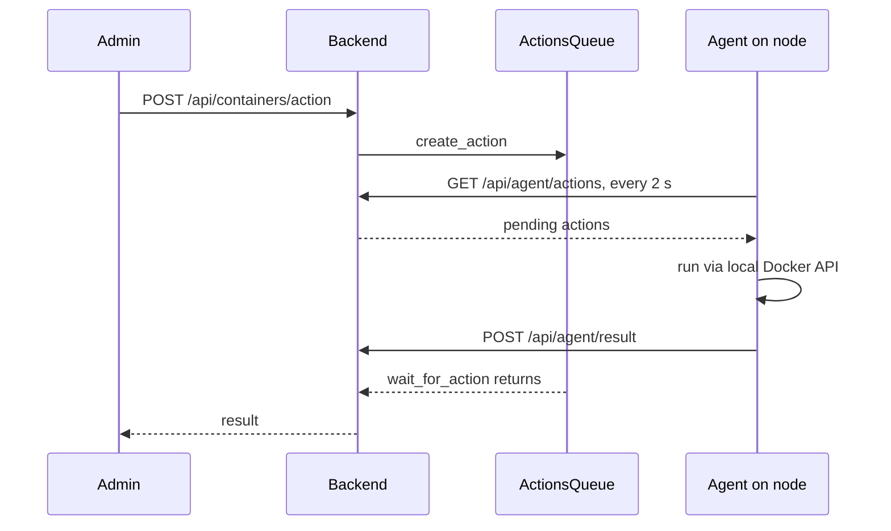

# Actions and remote execution

PulsarCD reaches hosts in several ways, which differ in privilege and failure behaviour. Keep them apart when changing anything here:

| Path | Used for | Runs on |
|---|---|---|
| Action queue | Container start and stop, exec, logs, env | The container's node, through its agent |
| Direct client | Fallback when no agent is online; legacy monitoring | Docker API or SSH, from the backend |
| Build SSH | Clone, build, deploy, `.env` edits | Build hosts and the swarm manager |
| Terminal | Interactive admin shell | The swarm manager |
| Docker socket | Reading Swarm state | The backend's node |

## Action queue

The backend doesn't call nodes directly. It queues an action, and the node's agent picks it up.

Action types are `container_action`, `exec`, `get_logs` and `get_env`.

### Persistence

The queue is mirrored to `<data_dir>/actions_queue.json`, and a restart behaves as follows:

- **Pending** actions are reloaded and still delivered, within their TTL from the original `created_at`, which is 60 seconds.
- **In-progress** actions are marked `failed` with a `reason`, since the agent may or may not have run them and the waiting HTTP caller is gone. A later result from the agent still overwrites this.
- Agents' `last_seen` is restored, so routing keeps working.

**Results are never written to disk**, because `get_env` and `exec` output can contain secrets. Finished actions are dropped after 5 minutes.

A file was chosen over VictoriaLogs because the queue is small, sits on the polling hot path, and must work before VictoriaLogs is reachable.

### Routing

`execute_container_action` tries an exact host name match, then a case-insensitive short hostname match, since an agent's hostname may differ from the Docker node's name, such as FQDN versus short name. If no agent is online, **it falls back to direct execution through the collector**.

### Agent identity

Three routes accept an agent key: `GET /api/agent/actions`, `POST /api/agent/result` and `POST /api/agent/system-error`.

| Configuration | Behaviour |
|---|---|
| `PULSARCD_AUTH__AGENT_KEY` only | One shared key, so a single compromised agent exposes the fleet |
| `PULSARCD_AUTH__AGENT_KEYS`, a JSON map | Each agent must present the key registered for its `agent_id`, and the shared key is no longer accepted |

Prefer per-agent keys. `agent_id` in the query and body must match, or an agent could authenticate as itself and act as a peer.

**`POST /api/agent/action` is not an agent route.** It can queue `exec` in any container on any host, so it needs an admin JWT.

## Background actions

Builds, tests and deploys run as `BackgroundAction` objects in `api`, each with an ID, status, output and cancel event. They live in memory: `get_action_status` falls back to recorded state on disk, but output in memory is lost on restart. The persistent record is [run history](../pipeline/build-test-deploy.md#run-history).

## Direct clients

`host_client.py` defines a common protocol, implemented by `docker_client.py` and `ssh_client.py`.

- **Docker API:** this includes the backend's read-only socket mount for Swarm queries. The `:ro` flag doesn't restrict the API, so treat it as root.
- **SSH (legacy monitoring):** hosts configured in `PULSARCD_HOSTS` with `mode: ssh`.

### SSH host key verification

The default is strict: **an unknown host aborts the connection** instead of trusting the offered key.

| Setting | Effect |
|---|---|
| `PULSARCD_SSH_KNOWN_HOSTS` | File path. The deployment uses `/data/known_hosts`, as `~/.ssh` is mounted read-only |
| `PULSARCD_SSH_ACCEPT_NEW_HOSTKEYS=true` | Trust on first use for hosts without an explicit path |
| Host's `ssh_known_hosts_path` | A path, `accept-new` or `none` |
| `PULSARCD_GITHUB__SSH_KNOWN_HOSTS_PATH` | Policy for the **build and deploy connection only**. **Defaults to `accept-new`** |

So the build connection, unlike others, trusts a new host key on first use by default. To bootstrap, run `ssh-keyscan` into the known hosts file on the data volume. Build commands use `shlex` quoting: keep that when adding any.

### Build hosts

`build_hosts.py` manages a pool. The primary, `github.ssh_host`, is also the swarm manager that deploys and owns `.env` files. `github.build_hosts` adds identical hosts only for builds and tests, sharing its SSH user, key, port and paths.

A host is chosen among those answering SSH: a repo stays where its layer cache is unless that host is clearly busier, otherwise the least loaded wins. `.env` files replicate from the primary on save and before each build. Images go through the registry, so a build on one host can deploy from another.

## Terminal

`/api/terminal/ws` opens an interactive shell on the swarm manager, using xterm in the UI.

- The handler validates the token itself, because WebSocket scopes never reach HTTP middleware.
- It requires `role == admin` and checks revocation.
- The token comes in `?token=`, as a browser can't set WebSocket headers. `backend/main.py` redacts it from access logs.
- It no longer falls back to the first host listed. Only a single-host setup can omit the `swarm_manager` flag, as this could otherwise open a shell on the wrong machine.

**This is full shell access on a manager**, and any admin session can use it.

## Adding a remote operation

1. **Viewers:** mutating routes are admin-only by default. Only allowlist a route for viewers after confirming it has no side effects. See [Authentication and access control](../security/authentication-and-access.md).
2. **New MCP tool:** add it to `DANGEROUS_TOOL_NAMES` if it changes anything.
3. **Secrets in output:** don't persist results, and don't log them, because logs are searchable by viewers.
4. **Convergence:** an action returning doesn't prove anything converged. Check Swarm task states.
