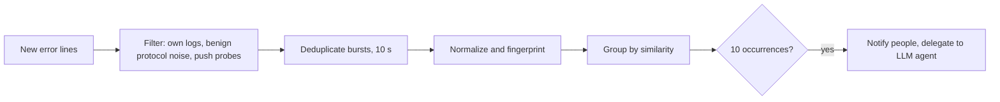

# Error detection and notifications

Two services turn events into attention. `RecurringErrorDetector` in `backend/error_detector.py` finds repeating errors in logs. `backend/notifier.py` sends messages to people. The detector always runs, even when no LLM agent or channel is configured, so that its history stays available.

## Recurring error detector

Every `scan_interval`, 60 seconds by default, the detector reads new `ERROR`, `FATAL` and `CRITICAL` lines from VictoriaLogs. The first scan looks back 12 hours. Later scans read only what arrived since the last, to avoid double counting.

| Default | Value |
|---|---|
| `min_occurrences` | 10 |
| `pattern_ttl_hours` | 12 |
| Similarity threshold | 0.92 |
| Burst window | 10 s, so one incident counts once |
| Re-notification | After 1 hour for a pattern |

**Normalization** strips volatile parts such as IDs and timestamps with `_STRIP_PATTERNS`, so the same error from different requests shares a fingerprint.

**Similarity** uses `zvec` if it can be loaded, and falls back to text hashing otherwise. This is optional, and the module logs which is active.

**Stack names** come from `_resolve_stacks`, and Swarm container names are parsed as `{stack}_{service}.{slot}.{taskid}`. Projects can be excluded, for instance PulsarCD's own stack.

### Filtering noise

Getting this wrong either hides failures or floods them out, so each filter is narrow:

- **Self logs** (`_SELF_LOG_PATTERNS`): PulsarCD's own structured events. Feeding them back would cause detection loops, and would reinject text into prompts. These patterns are anchored to specific phrases, to avoid filtering real application errors.
- **Benign registry 404s** (`_BENIGN_PATTERNS`): the registry logs protocol-level 404s at error level, thousands per day. Only the `sha256-<digest>` fallback tag is dropped. A missing **real** tag is kept.
- **Push probes:** a `HEAD` for an absent blob before uploading a layer is normal, while a `GET` for one means a broken image and is kept. `_filter_registry_push_probes` pairs candidates with a successful `PUT` within 5 seconds, waiting up to 60 seconds for slower ingestion.

Raw logs aren't changed: these only affect detection. The registry's referrers noise is further addressed in the PrivateNetwork stack.

### On a confirmed pattern

`_notify_recurring_error` sends a notification, then calls `llm_agent.handle_recurring_error` if an agent is configured. The agent applies [its own cooldown and tool policy](../ai/mcp-and-llm-agent.md#llm-agent), and its usual response is a PulsarTeam task. Patterns expire after their TTL, so slow recurrence may never reach the threshold.

## Notifier

Three independent channels are enabled by configuring `PULSARCD_NOTIFY__*`. **With nothing configured, it does nothing.**

| Channel | Settings | Notes |
|---|---|---|
| ntfy | `ntfy_url`, `ntfy_topic`, `ntfy_token` | On a public server, the topic name acts as a password |
| Webhook | `webhook_url`, `webhook_format` | The format follows the URL: Discord, Slack or generic |
| Email | `smtp_*`, `email_from`, `email_to` | STARTTLS by default |

| Event | Default | Helper |
|---|---|---|
| Pipeline failure | On | `notify_pipeline_stage` |
| Successful production deploy | **Off**, routine news | `notify_pipeline_stage` |
| Rollback | On | `notify_rollback` |
| Automatic edge ban | On | `notify_auto_ban` |
| Recurring error | On | `notify_recurring_error` |

### Guarantees

Callers are in the middle of pipelines and scanners, so:

- **Non-blocking.** `notify_*` helpers are synchronous, schedule delivery in the background and return immediately. Each channel has a timeout, 10 seconds by default, and errors are swallowed and logged.
- **Rate-limited.** The same key is sent at most once per `dedupe_seconds`, 900 by default, and at most `max_per_hour` go out per rolling hour, 30 by default. Dropped messages are counted and reported in the next one.
- **No secrets in messages.** They carry repo names, stages, versions, banned addresses and counts, never build output or `.env` values.

**Log samples are opt-in.** `include_error_samples` is off, as log lines can contain anything, and `redact()` is applied when it's on. The redaction is deliberately broad, since a false positive costs only some context.

**Delivery errors log only the exception type and HTTP status.** An aiohttp error message embeds the request URL, and a Discord or Slack webhook URL *is* its credential. Keep this rule when changing delivery code.

Notifications aren't persisted: a backend restart loses queued ones, and a channel outage means missed messages. So don't treat this as an audit trail. [Run history](../pipeline/build-test-deploy.md#run-history) is the record.

### Admin API

Under `/api/admin/notifications`, so restricted to admins by the middleware:

- `GET` returns channels, switches and the last delivery result, never any secret.
- `POST /test` sends a test message to each channel and reports each result.

## Testing

`tests/test_error_detector.py` and `tests/test_notifier.py`, with doubles for delivery.
