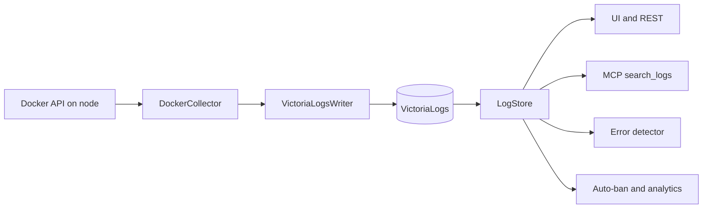

# Log collection and search

Agents on each node read Docker directly and write to VictoriaLogs **without passing through the backend**, so a busy or restarting backend doesn't stop collection. The backend only reads. Keep this separation: `agent/AGENTS.md` asks for it, and for host identity to be preserved in writes.



## Record kinds

Everything is in one instance, separated by a `kind` stream field. `shared/victorialogs.py` defines the layout, and is shared by backend and agents. **Don't add a backend-only dependency to `shared/`**, or the agent image breaks.

| Kind | Stream fields | Written by |
|---|---|---|
| `log` | `kind`, `host`, `container_name` | Agents |
| `container_metric` | `kind`, `host`, `container_name` | Agents |
| `host_metric` | `kind`, `host` | Agents |
| `access` | `kind`, `host` | Agents, derived from Traefik and WAF lines |
| `pipeline_run`, `pipeline_run_log` | `kind`, `repo` | Backend [run history](../pipeline/build-test-deploy.md#run-history) |
| `selftest` | `kind`, `host` | Connectivity probes |

**Stream fields identify a source and must never hold per-record values**, such as IDs, statuses or IPs. High cardinality there damages the store.

VictoriaLogs is append-only and stores all values as strings: numbers come back as `"12.5"`, and missing averages as `"NaN"`. Read them with `num` and `integer`.

## Collection

An agent runs three loops, with intervals set in `devops/docker-compose.swarm.yml`:

| Loop | Interval |
|---|---|
| Logs, `AGENT_LOG_INTERVAL` | 30 s |
| Metrics, `AGENT_METRICS_INTERVAL` | 15 s |
| [Action polling](../hosts/actions-and-remote-execution.md) | 2 s |

### Exactly once, approximately

Because VictoriaLogs has no document IDs, **a line sent twice is stored twice**, so the agent must avoid it:

- Docker's `since` has one-second resolution, so `collect_all_logs` drops lines that aren't newer than the last sent timestamp.
- On restart, `latest_log_times` looks up to 7 days back for the newest stored line per container, and collection resumes after it.
- After 20 consecutive empty cycles for a container, its timestamp is reset, and a tail-based fetch recovers from a stale state.

Consequences worth knowing:

- Lines sharing a timestamp with the last one sent can be dropped.
- **Only `running` containers are read.** A container that crashes between cycles can lose its final lines, up to 30 seconds' worth, and these are often the most useful ones. Use `docker service logs` on the node if needed.
- A new container gets at most `AGENT_LOG_LINES_PER_FETCH` lines of history, 500 by default.

### Parsing

`shared/log_utils.py` strips ANSI codes, detects level and HTTP status, and parses timestamps, for both backend and agent. Level and status come from heuristics on the message, so they may be wrong or absent for unusual formats.

Lines from the Traefik service also produce `access` records, through `shared/access_log.py`. See [Edge security and usage analytics](../security/edge-security-and-usage.md).

### GPU metrics

The agent's compose settings expose AMD and NVIDIA devices so GPU metrics can be collected on any node, using `shared/gpu_utils.py`.

### Legacy collector

`backend/collector.py` collects over SSH or the Docker API when hosts are configured in `PULSARCD_HOSTS`, and `collector.agents_only` limits it. This remains for backwards compatibility, and agents are the normal path. It's also the fallback for [container actions](../hosts/actions-and-remote-execution.md#routing) with no agent online.

## Searching

`backend/log_store.py` answers UI, MCP and AI queries.

### Building queries safely

**Never build LogsQL from input by concatenation.** Use the helpers:

| Helper | Purpose |
|---|---|
| `quote` | Values |
| `field` | Names |
| `stream`, `exact`, `any_of` | Filters |
| `text_filter` | Free-text search |

`text_filter` supports words, quoted phrases, trailing `*`, `AND`, `OR`, `NOT` or `-word`, and parentheses. Every term becomes a quoted literal, so typed `field:value`, regexes and pipes are searched as text and can't change the query. That's why `field:value` in the normal search finds nothing: use `hosts`, `containers` and similar parameters to filter by field.

Words match whole, so `error` doesn't match `errors`, but `error*` does.

### Raw LogsQL

The MCP `search_logs` tool's `logsql` parameter accepts real LogsQL for statistics:

```text
level:in(ERROR, FATAL) | stats by (compose_project) count() as errors
```

`run_logsql` confines it with `extra_stream_filters={"kind": "log"}`, which VictoriaLogs applies to the query and every subquery, whatever it says. So access records and pipeline logs can't be read this way.

### Limits

VictoriaLogs has no authentication, so all queries from input are bounded here as well:

| Limit | Value |
|---|---|
| Hits per search | 500 |
| Deepest page offset | 10,000 |
| Rows from raw LogsQL | 500 |
| Raw LogsQL window | 30 days |
| Search window from a request | 1 year |
| Free-text length | 2,048 characters |
| Server-side query duration | 60 s |

## Security notes

- **Any viewer can search all container logs.** `POST /api/logs/search` is on the viewer allowlist. So anything an application logs, including a secret, is readable by every viewer, and through the read MCP server. That's why tokens in URLs were eliminated or redacted in the backend's own logs.
- **Logs are attacker-influenced text.** Anyone able to trigger an error can write to them, so treat them as untrusted in the UI and in LLM prompts.
- **Keep VictoriaLogs private:** it has no authentication.

## Retention

A single retention applies to all kinds: `VICTORIALOGS_RETENTION`, 90 days by default, and `VICTORIALOGS_MAX_DISK`, 50 GiB by default. Noisy logs can therefore push out pipeline history, since the oldest days go first when the disk cap is reached.

## Testing

Storage tests use the `vlogs` fixture and need a `victoria-logs` binary or `VL_TEST_URL`. Otherwise they are skipped. See [Testing and checks](../development/testing-and-checks.md#tests-that-may-be-skipped).
