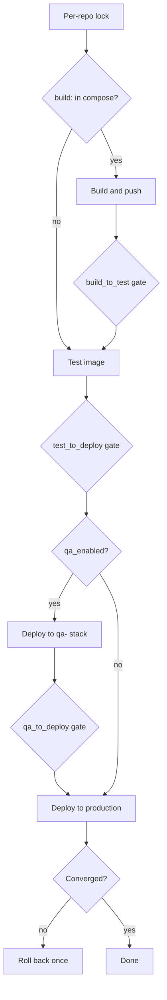

# Build, test and deploy pipeline

PulsarCD builds its starred GitHub repositories on a build host, tests them in containers, deploys them to Swarm and checks that they actually converged. `_trigger_pipeline` in `backend/pipeline_runner.py` is the chain, and the shell scripts in `scripts/` do the host-side work over SSH.

## What triggers a run

| Trigger | Path |
|---|---|
| Push webhook | `POST /api/webhooks/github`, HMAC-signed |
| Poller | `auto_build_poller`, every 10 seconds, or longer with a webhook configured |
| UI | `/api/stacks/...` routes |
| MCP | `trigger_pipeline` |

**A push to a repo's default branch on a starred repository ships it, by default**, if the gates are left automatic. The webhook and poller both use `_auto_build_commit`. It honours the `version_to_build` gate, auto-tags untagged commits, and advances `last_sha`.

**The webhook:**

- `X-Hub-Signature-256` is checked in constant time, against `PULSARCD_GITHUB__WEBHOOK_SECRET`.
- Recent `X-GitHub-Delivery` IDs are remembered, so a captured request can't be replayed.
- Only default branch pushes count, and the repo must be starred.
- It responds immediately and works in the background, as GitHub gives up after 10 seconds.

The poller uses `pushed_at` from the starred list to skip unchanged repos cheaply, with 3 repos checked concurrently.

## The chain

`_acquire_build_lock` deduplicates every caller: a second trigger for a repo returns `False` while one is running. The lock is in-process, and so it relies on the single replica. Pipelines of different repos run concurrently.

A repo with no `build:` directive skips straight to test. The clone is updated first, so newly added directives count.

Build and test run on a host chosen from the [build pool](../hosts/actions-and-remote-execution.md#build-hosts). QA and deploy always run on the primary, the swarm manager.

### Gates

Set per project and per transition with `set_transition_config`, or in the UI.

| Mode | Behaviour |
|---|---|
| `auto` | Always proceed |
| `auto_with_success` | Proceed when the stage succeeded. **Default**, except for QA |
| `agent` | `llm_agent.evaluate_gate` decides. Without an LLM configured, **the gate refuses** |
| `manual` | Stop, recording `gate_rejected`, and wait for a person |

`qa_to_deploy` **defaults to `manual`**. So enabling QA stops each release after QA until someone promotes it, for instance with `deploy_stack`.

`gate_rejected` is therefore not always a failure: for a manual gate, it means it is waiting.

## Build

`scripts/build-push.sh <folder> <version> [branch] [commit]` updates the repository, builds images from `devops/docker-compose.swarm.yml`, tags the repo with a semantic version such as `v1.0.42`, and pushes images. The version parameter is major.minor, and the patch number is auto-incremented.

Services sharing an image repository with different source tags get release tags with a variant, such as `rocm-1.0.42`. Preview tags, `pv-<slug>`, are handled separately. See [Preview environments](preview-environments.md).

## Test

`scripts/test.sh` runs the `test` service from the project's compose file. **This is for deployed projects, not for checking this repo**, because it changes a Git checkout and runs Docker Compose. See [Testing and checks](../development/testing-and-checks.md).

## Deploy and verification

`docker stack deploy` returns as soon as Swarm accepts the specs, before anything new runs. So `scripts/deploy-service.sh`:

1. Updates the repo, and runs `docker-compose.pre.sh` if present.
2. Rewrites image tags to the chosen version, and converts secrets. See [Project integration](project-integration-and-secrets.md).
3. Runs `docker stack deploy`.
4. **Verifies** with `scripts/verify-deploy.sh`.
5. Runs `docker-compose.post.sh`, only if verified.

### Convergence

`verify-deploy.sh converge` waits until each service runs its requested replicas on the new image, and stays there. It handles `replicas: 0`, global mode, jobs, and one-shot services. It fails when a task from this deploy is `Failed` or `Rejected`, or Swarm paused or rolled back the update, or the timeout expires. A baseline of existing task IDs stops old failures being blamed on this deploy.

| Project `devops/.env` setting | Default | Note |
|---|---|---|
| `DEPLOY_VERIFY` | `true` | `false` skips the checks |
| `DEPLOY_CONVERGE_TIMEOUT` | 180 s | **Raise this for services with slow startup** |
| `DEPLOY_CONVERGE_STABLE` | 10 s | Must stay converged |
| `DEPLOY_CONVERGE_MAX_FAILURES` | 0 | |
| `DEPLOY_HEALTHCHECK_PATH`, `_URL` | None | Optional HTTP probe |
| `DEPLOY_HEALTHCHECK_TIMEOUT` | 60 s | |

Services that load large models for a long time can fail this with its default timeout, even when they would eventually start. AIFabric's GPU services are an example.

### Rollback

A failed verification exits with code 3, and prints `PULSARCD_DEPLOY_VERIFICATION_FAILED`. **That line is the contract with `backend/deploy_rollback.py`, so keep them in sync.**

- Only that case rolls back. An earlier failure, in checkout, pull or the pre-hook, happens before Swarm is touched, so the old version still runs.
- The target is the last version recorded as successful for that stage, production or QA.
- **It is attempted once.** If the previous version also fails verification, the failure is reported with no further attempts.
- The post-deploy hook isn't run on failure.
- `last_rollback` in pipeline state records it, and a notification goes out.

Disable with `PULSARCD_GITHUB__AUTO_ROLLBACK=false`. A project can also set Swarm's own `failure_action: rollback`. The check then sees `rollback_*`, reports failure, and PulsarCD redeploys the whole stack at the previous version.

Rollback covers images. Database migrations and data changes aren't undone, so a rollback may run old code on a new schema.

## Failures

`_notify_agent_failure` passes build, test, QA and deploy failures to the [LLM agent](../ai/mcp-and-llm-agent.md#llm-agent), and `_set_pipeline` sends notifications. A cancelled action doesn't count as a failure to investigate.

Cancellation uses a `cancel_event` passed through each stage, available with `cancel_action`.

## State and restarts

`backend/pipeline_state.py` keeps current state per repo in `/data/pipeline_state.json`, with up to 500 log lines per stage.

**Pipelines run as asyncio tasks in the backend, so they don't survive a restart.** On load, any stage marked `running` becomes `failed` with `status_reason`, and no automatic resume happens. The work on remote hosts may have continued or been left half done, so check before retrying. Deploying PulsarCD itself restarts the backend.

The auto-build state, including build locks, lives in memory.

## Run history

`backend/run_history.py` records each stage run in VictoriaLogs, because pipeline state only holds the latest:

- `kind=pipeline_run`: repo, stage, version, commit, trigger, actor, timings, status and error excerpt. A run is written on start and on end, and its current state is its latest record.
- `kind=pipeline_run_log`: the log, in chunks, keyed by `run_id`.

This answers "what changed before the outage", through Stacks > History, `/api/pipeline/runs`, and the MCP `get_pipeline_history` and `get_pipeline_run` tools.

- **Writes are fire-and-forget**, so history can never slow or break a deployment, and may have gaps if VictoriaLogs is down.
- **Logs are masked before storage** for tokens, URL passwords, authorization headers and `KEY=value` secrets, because they're kept for months and viewers can search them. Masking is pattern-based, so don't echo secrets in build output.
- Retention is shared with all other VictoriaLogs data.

## Testing

`tests/test_pipeline_chain.py`, `test_pipeline_state.py`, `test_deploy_rollback.py`, `test_deploy_verify.py`, `test_build_push.py`, `test_run_history.py` and `test_github_webhook.py`. Bash scripts are tested with fake executables on a temporary `PATH`.
