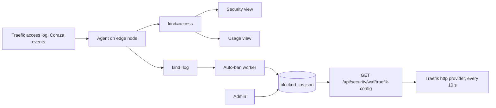

# Edge security and usage analytics

Enforcement lives in the PrivateNetwork edge stack, while PulsarCD does the analysis and decides who is blocked. The two repositories form one system, so changes here may need a matching change there.

## Access records

A log line keeps Traefik's JSON as a string, which can't answer "which IP sent the most requests". So `shared/access_log.py` turns each relevant line into a flat `kind=access` record, with client IP, host and path as fields. There are two event types:

- `request`: from a Traefik JSON access line. It must have `ClientHost`, `DownstreamStatus` and `RequestPath`, so that other containers' JSON logs aren't mistaken for one.
- `waf_block`: from a line containing `Coraza: Access denied`, parsing the `[id "..."]`, `[uri "..."]` and `[client "..."]` fields.

**This format is a contract with the WAF connector** in PrivateNetwork's `edge/waf/logging.go`. Lengths are capped, since a client controls much of this text.

## Security view

`backend/security_analytics.py` is pure: it builds LogsQL and interprets rows without touching VictoriaLogs, so rules can be tested directly. `LogStore.get_security_overview` runs two rounds: rank candidates, then compute details for only those.

| Client signal | Threshold in the window |
|---|---|
| Flood | 300 requests per minute at peak |
| Burst | 120 requests per minute at peak |
| Scanner | 30 not-found answers across 20 distinct paths |
| Denied | 30 of 401 or 403 |
| Rate limited | 10 of 429 |
| WAF | 3 blocks |
| Mostly errors | 80% of at least 20 requests |

Endpoints are flagged when one client sends 80% of at least 200 requests (concentrated), or when at least 5 clients produce 90% errors over at least 50 requests (a distributed scan). Over long windows, bursts are smoothed, because peak buckets are wider.

The window is 5 minutes to 7 days, with an explorer for the latest 500 matching requests. Top lists are sampled, while category totals are exact. **Viewers can see this view**, and so can see client addresses.

## Usage view

`backend/usage_analytics.py` reads the same records to report requests, clients, latency and errors per endpoint, host and domain.

An access line names the Traefik *router*, not the stack. So stacks are resolved from `traefik.http.routers.*` labels on Swarm services, mapped to `com.docker.stack.namespace`. Anything no deployed stack claims is reported as **unattributed** and isn't dropped, so per-stack rows add up to the total.

A stack removed since the request also shows as unattributed, as mapping uses current labels.

## Blocklist

`backend/ip_blocklist.py` stores entries in `<data_dir>/blocked_ips.json`, holding addresses or CIDR ranges, up to `MAX_ENTRIES`, 500. `POST` and `DELETE /api/security/blocklist` need an admin.

`traefik_config` renders a Traefik dynamic configuration:

- An HTTP router and a TLS router match all blocked addresses, at priority 1,000,000.
- That's above application routers and below Traefik's ACME router, so a blocked client can't stop certificate renewal.
- Traefik has no deny middleware. So an `ipAllowList` allowing only an address no packet can come from has the same effect, answering 403.

Nothing is written on the edge node. Traefik polls the endpoint every 10 seconds with `PULSARCD_AUTH__EDGE_KEY`. The objects sit in the `http` provider's namespace, so a mistake can only break this router.

**Sources disagree on one point.** This module's docstring says a blocked address "never reaches the WAF, the rate limiter or any application". PrivateNetwork's `edge/traefik.yml` says the entrypoint's WAF and rate limiter still run before this router's deny middleware, which is consistent with where those middlewares are attached. So assume blocked clients still consume some WAF capacity, but never reach an application.

**If `EDGE_KEY` is unset here, or `PULSARCD_EDGE_KEY` on the edge, nothing is enforced**, even though the UI still records blocks. The edge keeps its last fetched list when PulsarCD is down. Expired entries therefore stay enforced until polling works again.

`scripts/test-edge-blocklist.py` validates real Traefik enforcement in local containers, using Docker Desktop's `desktop-linux` context.

## Automatic bans

`AutoBanWorker` in `backend/auto_ban.py` bans a public client after **one** probe, for 24 hours by default.

`PULSARCD_AUTOBAN__ENABLED` is `true` in the Swarm compose file, although `AutoBanConfig` defaults to off.

### What triggers it

- **Probe paths:** dotenv and `auth.json`, VCS metadata, credential files, admin and exploit endpoints, dumps, PHP scripts and WordPress. `probe_kind` applies the same two URL decodes and normalization as the WAF, to the path only.
- **Scanner `User-Agent`s.**

**These patterns must stay equivalent to rules 1005 to 1013 in PrivateNetwork's `edge/dynamic.yml`.** Nothing enforces this, as they live in different repositories. If a rule is narrowed for a legitimate application but this isn't, its users still get banned from the logs.

### What it trusts

Only Docker-attributed access logs count: the record's `compose_project` and `compose_service` must match `traefik_project` and `traefik_service`, which are Docker metadata that clients can't set. **Client text isn't trusted**, whether a forwarded header or a Coraza message that interpolates request text. Because `kind=access` records drop container provenance, this worker reads `kind=log` instead.

`ClientHost` is the connection's peer, which is why the edge must publish ports in host mode.

### What is never banned

| Exemption | Reason |
|---|---|
| Private, local, multicast and reserved addresses | Not public clients |
| `PULSARCD_AUTOBAN__EXEMPT_CIDRS` | Configured |
| Cloudflare ranges, `exclude_cloudflare` | A proxy peer is shared by unrelated users |
| **Addresses of recent admin sessions** | See below |

**Operator addresses:** an admin checking that the WAF blocks `/.git/config` looks exactly like a scanner, and a ban would lock them out of the unblock button. So `auth_middleware` records addresses of admin sessions, and the worker leaves those alone for the ban duration, also releasing existing automatic bans if they become exempt. The WAF still refuses the request. These are held in memory, up to 256, and restored as the console polls after a restart. A burst shortly after a restart, before an admin's next poll, could still ban that admin.

The cost is that someone sharing an address with an admin, such as on the same NAT, isn't automatically banned.

### Behaviour

- A checkpoint in `<data_dir>` survives restarts, and each scan rereads `overlap_seconds`, 300 by default, to catch late logs.
- Requests denied by the blocklist router are ignored, so a client can't keep refreshing its own ban.
- A removed ban isn't recreated by replaying a processed probe, but a new probe can recreate it.
- Manual bans are permanent. Automatic ones expire, and a full list is reported in logs.
- A new ban sends a [notification](../observability/errors-and-notifications.md).

Banning takes time: agent collection, then indexing, then the detector's poll, then Traefik's poll. The WAF rejects the request itself immediately.

## Testing

`tests/test_access_log.py`, `test_security_analytics.py`, `test_usage_analytics.py`, `test_ip_blocklist.py`, `test_auto_ban.py` and `test_security_view.cjs`.
